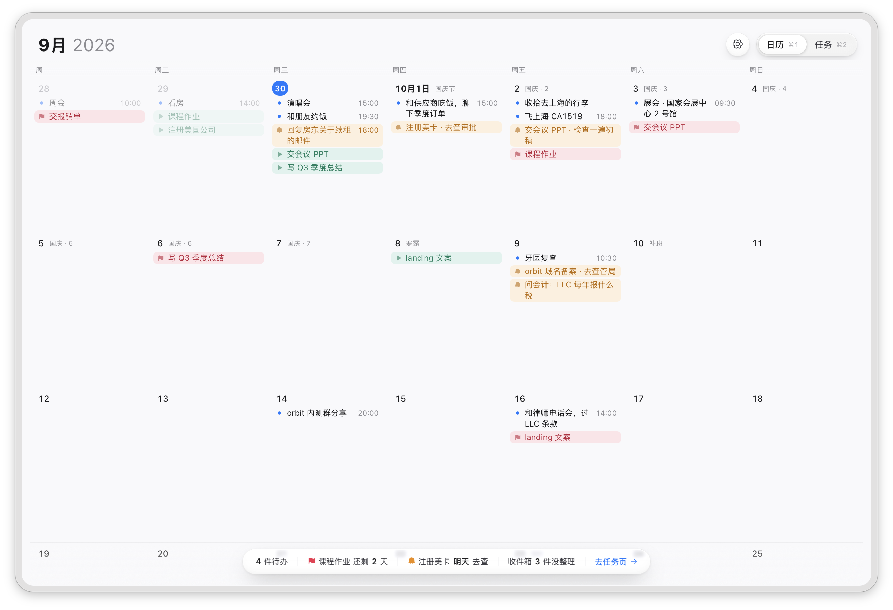
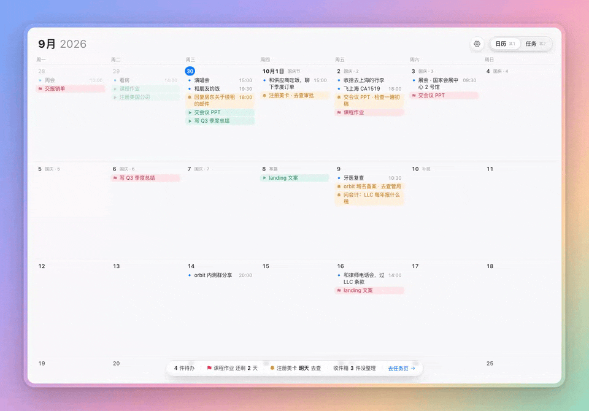
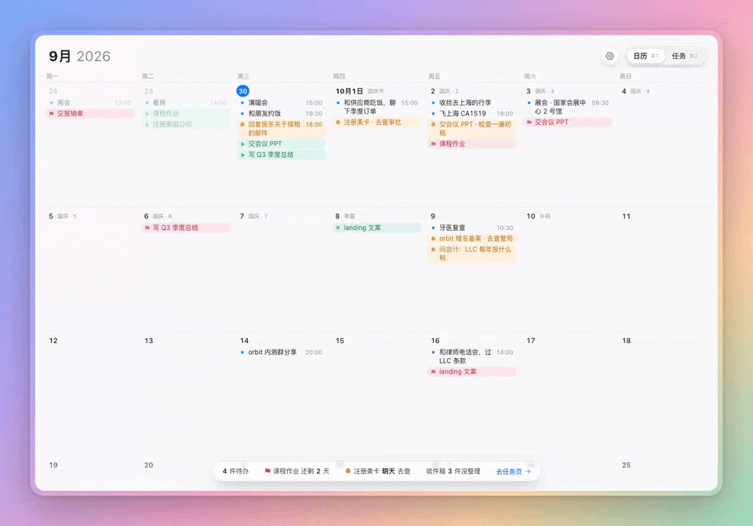
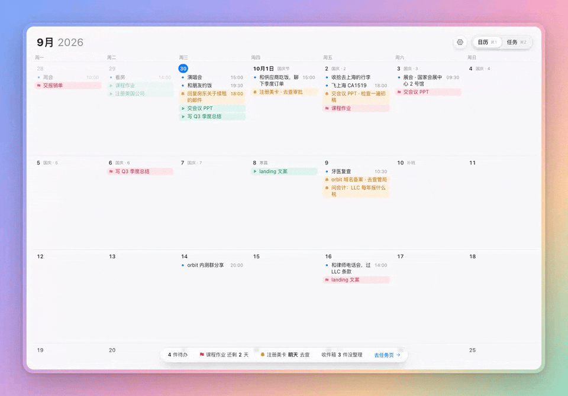
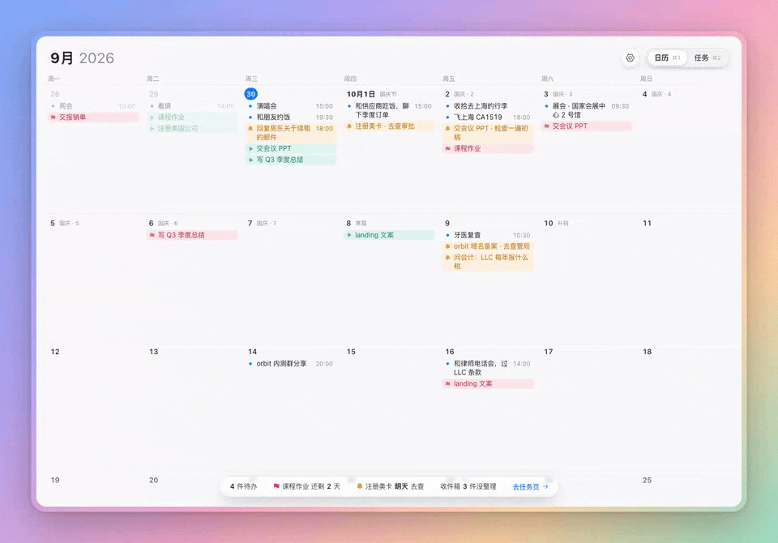
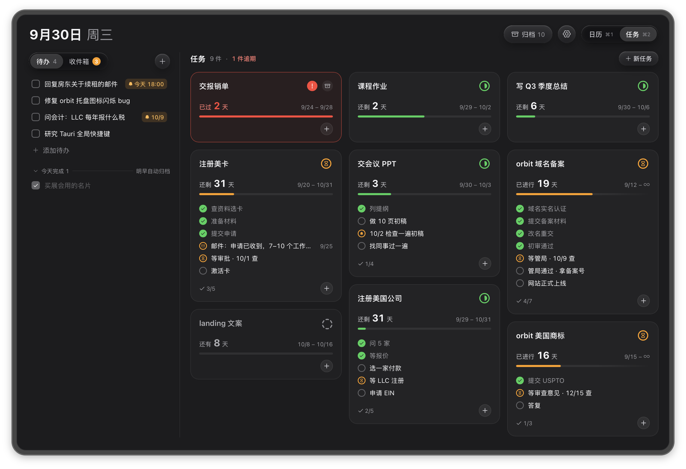
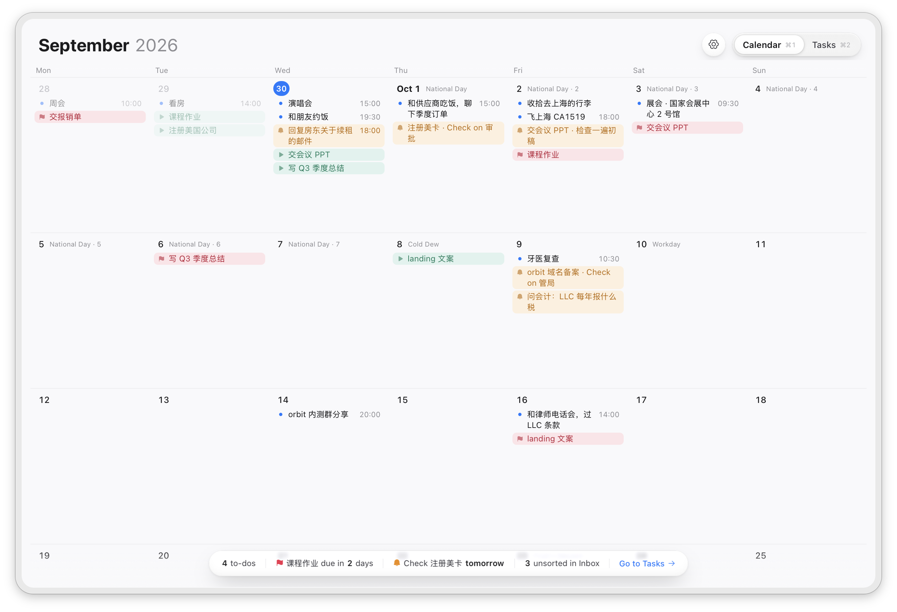
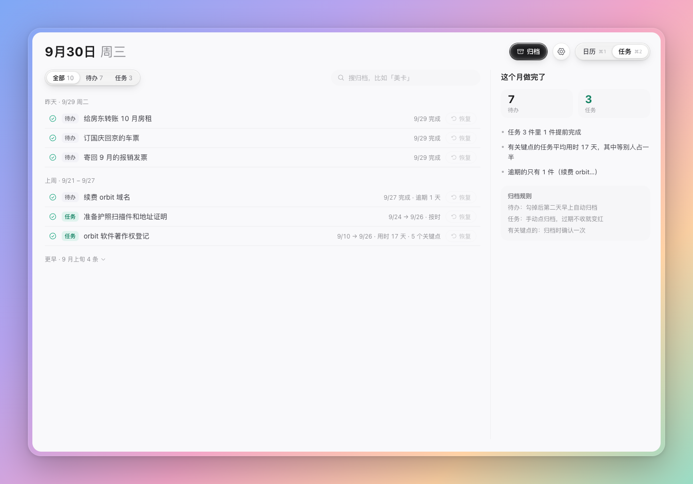
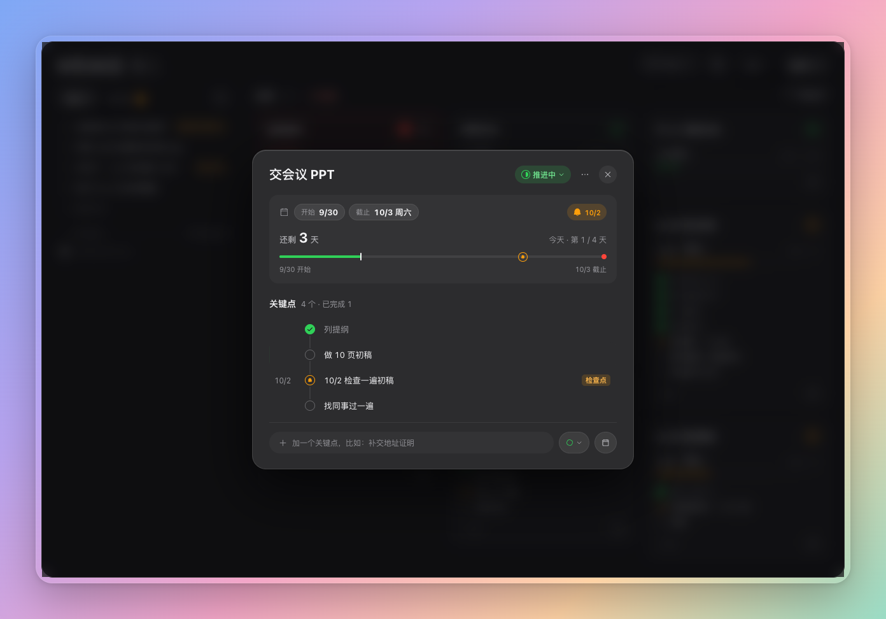

<div align="center">


# WeekPage Classic

**按一下快捷键，日历、待办、收件箱和任务看板就浮在眼前。**

数据只在本机，不注册、不联网。macOS + Windows，Tauri 2（Rust）+ React。

[](https://github.com/heyleeon/weekpage-classic/releases/latest)
[](https://github.com/heyleeon/weekpage-classic/releases)
[](LICENSE)


简体中文 · [English](#english)

</div>

<picture>
  <source media="(prefers-color-scheme: dark)" srcset="docs/media/window-dark.png">
  
</picture>

> [!NOTE]
> **维护模式**：这是 WeekPage 1.0，2026-10-11 冻结，2026-10-22 以 MIT 开源。只修 bug，不加功能。想要多设备同步，看作者在做的新版 [weekpage.app](https://weekpage.app)（不共用代码和数据格式）。

## 动起来看看

按 ⌘2，日历横着滑走、任务页滑进来；点一张卡打开详情。第一次打开详情时，关键点会自己「探个头」，告诉你它能左右滑。



## 能做什么

### 一个快捷键，随叫随到

- macOS **⌃⌥Space**、Windows **Ctrl+Alt+Space**：窗口在鼠标所在的屏幕正中出现，永远在最上层，能盖在全屏应用上。
- 点别处就自动收起，像 Spotlight；不想收就在设置里钉住。
- 不占 Dock / 任务栏，菜单栏（托盘）常驻一个小图标；有关键点逾期时图标上出红点。

### 日历和任务页，横着滑过去

触控板两指一扫，页面跟着手指走，松手弹过去，再扫回来。也可以点右上角的胶囊，或者按 ⌘1 / ⌘2。


### 双击就写，时间自己认

在格子里双击，打「下午3点半 和 A 喝咖啡」，下面那行预览告诉你会存成「15:30 和 A 喝咖啡」。回车即存，不弹任何选时间的框。



| 你打的 | 存成 |
|---|---|
| 下午3点半 和 A 喝咖啡 | 15:30 和 A 喝咖啡 |
| 3-5点 开会 | 15:00–17:00 开会 |
| 8pm standup | 20:00 standup |
| 中午 吃饭 | 12:00 吃饭 |
| 明天下午3点 开会 | 15:00 明天 开会（日期由你双击的格子决定，「明天」留在标题里） |

### 拖到哪天就是哪天

按住条目一拖，占位块告诉你会落在哪；松手就改了日期，Toast 里一键撤销。拖到网格上下边缘停一下，会自动翻周。



### 翻周像翻纸

滚轮、触控板、按住空白处拖，都按周滑动；离开这一周时右上角浮出「回到今天」，按 T 回家。可以显示 2 / 3 / 4 周。中国大陆的法定节假日、调休和节气直接印在日期旁边。


### 任务卡：一眼看出进度和卡在哪

卡片带时间条和关键点。关键点有三种：**我来做**、**等别人**、**检查点**。打字时自动判型：「等管局回复」是等别人，「10/2 检查一遍初稿」是 10/2 的检查点。检查点过了日期没勾就标红，今日速览胶囊和菜单栏图标一起提醒你。

详情面板里，关键点右滑完成、左滑删除、上下拖动排序。



### 收件箱：先记下，再整理

想到什么先丢进收件箱。有空时四个去向：**今天** / **定日期** / **变任务** / **删掉**。变任务时在小日历上点两下就是起止日期，新卡会在看板上亮一下。


### 白天黑夜，中英双语

跟随系统或手动选；语言切换立刻生效，不用重启。节日和节气名也有英文。

<table>
  <tr>
    <td width="50%"></td>
    <td width="50%"></td>
  </tr>
</table>

### 做完的事不白做

待办勾掉后第二天早上自动归档；任务手动归档，有关键点的会让你确认一次。归档页按周分组、能搜，右边是这个月的小结。

<table>
  <tr>
    <td width="50%"></td>
    <td width="50%"></td>
  </tr>
</table>

还有：到点系统通知、开机自启、所有操作都能撤销（⌘Z，或点 Toast 里的「撤销」）。

## 下载

- **macOS 13+**（Apple 芯片和 Intel 通用）：到 [Releases](https://github.com/heyleeon/weekpage-classic/releases/latest) 下载 `WeekPage_<版本>_universal.dmg`，已签名并经 Apple 公证，打开后把 WeekPage 拖进「应用程序」。
- **Windows**：还没有安装包，请从源码构建（见下面）。Windows 版只经过 CI 验证：每次推送都会在 Windows 上编译并打出 NSIS 安装包，真机上还没跑过。真机验收的清单见 [`docs/roadmap.md`](docs/roadmap.md)。

## 怎么用

### 快捷键

「mod」= macOS ⌘ / Windows Ctrl。

| 作用 | macOS | Windows |
|---|---|---|
| 呼出 / 隐藏窗口（设置里可改） | ⌃⌥Space | Ctrl+Alt+Space |
| 日历页 / 任务页 | ⌘1 / ⌘2 | Ctrl+1 / Ctrl+2 |
| 新建任务 | ⌘N | Ctrl+N |
| 设置 | ⌘, | Ctrl+, |
| 撤销 | ⌘Z | Ctrl+Z |
| 关掉当前浮层；都关完了就隐藏窗口 | Esc | Esc |
| 隐藏窗口 | ⌘W | Ctrl+W |
| 退出 | ⌘Q，或菜单栏图标的菜单 | 托盘图标的菜单 |
| 日历：前一周 / 后一周 | ↑ ← / ↓ → | 同 |
| 日历：回到今天 | T | T |
| 日历：删除选中的日程 | ⌫ | Delete |
| 日历：选中的条目在当天内上下移 | ⌥↑ / ⌥↓ | Alt+↑ / Alt+↓ |
| 收件箱：选中一条后整理 | ↑↓ 选，T 今天 · D 定日期 · R 变任务 · ⌫ 删掉 | 同 |
| 归档页：搜索 | ⌘F | Ctrl+F |
| 浮层里提交 | ⌘↩ | Ctrl+Enter |

### 手势

- **换页**：触控板两指左右扫。
- **翻周**：滚轮、两指上下滑、按住网格空白处拖；快速甩一下多翻一周。
- **拖条目**：同一天排序，或拖到别的日子；拖到网格上下边缘停一下翻周。
- **待办排序**：按住竖向拖 4px 就起来，不用长按。
- **详情里的关键点**：右滑完成、左滑删除、上下拖动排序。
- **窗口**：工具栏空白处拖动；四边可以拉大缩小，最小 1100×680。

### 快捷键被占用了（⌃⌥Space）

macOS 默认把 ⌃⌥Space 给了「选择输入法菜单中的下一个输入法」。WeekPage 启动时会读系统快捷键表，冲突时在首启提示条和设置面板里提示怎么处理。两种处理：

1. 系统设置 → 键盘 → 键盘快捷键 → 输入法，关掉「选择输入法菜单中的下一个输入法」；
2. 或者在 WeekPage 设置（⌘,）里录一个别的快捷键。

## 隐私

数据库、设置和备份都在本机。App 唯一的联网请求：每周最多一次，从 jsDelivr 拉一份节假日数据（`chinese-days.json`），失败就用打包时自带的那份，不带任何个人数据。CSP 只放行这一个域名（`backend/tauri.conf.json`）。

## 从源码构建

<details>
<summary>准备、跑起来、命令、开发身份与正式身份、装到 macOS</summary>

### 准备

- Node 24 + pnpm 10
- Rust：rustup（仓库根 `rust-toolchain.toml` 固定 1.97.1 + rustfmt + clippy，第一次 cargo 会自动装）
- macOS：Xcode Command Line Tools；Windows：WebView2（Win11 自带）+ MSVC Build Tools
- **Windows 上 clone 之前**：打开「开发者模式」，并执行 `git config --global core.symlinks true`——`.claude/` 里是指向 `.agents/` 的软链接，没开就会变成普通文本文件（`bash scripts/sync-agent-config.sh --heal` 可以修复）。

```bash
pnpm -C frontend install
```

### 跑起来

```bash
# 浏览器预览（内存假后端 + demo 数据，用来对稿 / 截图）
pnpm -C frontend dev
# → http://localhost:1420/?now=2026-09-30T10:00

# 真 App（开发身份「WeekPage Dev」），带演示数据和固定时钟
WEEKPAGE_SEED=demo WEEKPAGE_FAKE_NOW=2026-09-30T10:00 pnpm -C frontend tauri:dev
```

- 开发身份的快捷键是 **⌃⌥⇧Space**（Windows Ctrl+Alt+Shift+Space），按一次呼出、再按一次隐藏。
- `WEEKPAGE_SEED=demo`：空库启动时写入演示数据；`WEEKPAGE_FAKE_NOW=YYYY-MM-DDTHH:MM`：假时钟（从这一刻继续走）。
- `WEEKPAGE_DATA_DIR` / `WEEKPAGE_LOG_DIR`：换数据 / 日志目录，试东西时用 `$(mktemp -d)` 不弄脏仓库里的 `data/`。
- 以上开关都只在 debug 构建生效，完整列表见 [`.env.template`](.env.template)。debug 构建的数据默认在仓库根 `data/`，日志在 `logs/`（都不入库）。

### 命令

| 命令 | 作用 |
|---|---|
| `bash scripts/check.sh` | 全部检查（提交前必跑）：镜像 → CJK → 边界 → biome → tsc → vitest → fmt → clippy → cargo test |
| `bash scripts/check.sh fe` / `be` | 只跑前端 / 后端那半 |
| `bash scripts/check.sh win` | 在 macOS 上交叉检查 Windows 目标能否编译（需 `rustup target add x86_64-pc-windows-gnu` + `brew install mingw-w64`，没有就 SKIP） |
| `bash scripts/gen-contracts.sh` | 改了 Rust 类型 / 命令 / seed 后，重新生成 `frontend/src/types/bindings.ts` 与 demo 快照 |
| `pnpm -C frontend tauri:build:debug` | debug 包：`backend/target/debug/bundle/macos/WeekPage Dev.app` |
| `pnpm -C frontend tauri:release` | 正式包（正式身份，ad-hoc 签名）：`backend/target/release/bundle/macos/WeekPage.app` + `dmg/` |
| `bash scripts/release.sh --publishable` | 发版用的 DMG：universal、Developer ID 签名、公证（凭据的写法见脚本开头） |
| `WEEKPAGE_DEBUG_SMOKE=1 WEEKPAGE_DATA_DIR=$(mktemp -d) backend/target/debug/weekpage` | 冒烟：显示 → 隐藏 → 显示 → 发一条通知 → 退出码 0 |

本页的截图和 GIF 由 [`scripts/readme-media/`](scripts/readme-media/) 生成，改了界面重跑一遍就行。

### 开发身份与正式身份

| | 开发（默认） | 正式 |
|---|---|---|
| 配置 | `backend/tauri.conf.json` | 叠加 `backend/tauri.release.conf.json` |
| identifier / 名字 | `app.weekpage.dev` / WeekPage Dev | `app.weekpage` / WeekPage |
| 默认快捷键 | macOS ⌃⌥⇧Space · Windows Ctrl+Alt+Shift+Space | macOS ⌃⌥Space · Windows Ctrl+Alt+Space |
| 开机自启 | 永不 | 首次启动默认开 |
| 数据 | 仓库 `data/` `logs/` | 系统应用数据 / 日志目录 |

除了 `tauri:release`，任何构建（`tauri dev`、`tauri build --debug`、`cargo test`）都是开发身份，不会和装好的正式版抢单实例或快捷键。

**要发布自己的改版**：先把两份配置里的 `identifier` 换成你自己的（比如 `com.example.myweek`），名字和图标也换掉（见下面「许可证」）。不换的话，你的包和官方的 WeekPage 会共用同一个数据目录，互相覆盖数据。

### 装到 macOS

```bash
pnpm -C frontend tauri:release
osascript -e 'quit app id "app.weekpage"' 2>/dev/null   # 已装的旧版先退出
rm -rf "/Applications/WeekPage.app"
ditto "backend/target/release/bundle/macos/WeekPage.app" "/Applications/WeekPage.app"
open "/Applications/WeekPage.app"
```

- ad-hoc 签名、未公证：本机构建的包能直接打开；从别的机器拷来的要先 `xattr -dr com.apple.quarantine "/Applications/WeekPage.app"`。
- 首次启动会注册开机自启（`~/Library/LaunchAgents/WeekPage.plist`，系统设置 → 登录项里能看到），第一次到点提醒时请求通知权限。
- 数据在 `~/Library/Application Support/app.weekpage/`：`task-desk.db`（改名前的文件名，没改；设置也在这个库里）+ 每天一份备份 `backups/task-desk-YYYYMMDD.db`；日志在 `~/Library/Logs/app.weekpage/`。
- Spotlight 搜「WeekPage」打开；已经在运行时只会把原窗口叫出来。

</details>

## 目录

```
frontend/   React 界面（lib/ 纯函数、hooks/ 状态、components/ 界面、design/ 令牌）
backend/    Tauri / Rust（commands、db 写路径、shell 窗口与系统集成、platform 平台差异）
docs/       架构、界面规格、没做完的切片、长期记忆；media/ 是本页的图
scripts/    质量门与生成脚本；readme-media/ 生成本页的截图和 GIF
```

设计文档：[`docs/architecture.md`](docs/architecture.md) · [`docs/ui-spec.md`](docs/ui-spec.md) · [`docs/roadmap.md`](docs/roadmap.md)。用 AI 编程助手改代码时，它会读 [`.agents/AGENTS.md`](.agents/AGENTS.md)（`.claude/CLAUDE.md` 是它的软链接）。

## 参与

- **Bug**：欢迎提 issue 或 PR。PR 提交前跑一遍 `bash scripts/check.sh`，全绿再提。
- **新功能**：本仓不收，请别花时间写。

## 许可证

代码按 [MIT](LICENSE) 授权。**WeekPage 这个名字和 `backend/icons/` 里的图标不在授权范围内**，见 [TRADEMARKS.md](TRADEMARKS.md)。

---

## English

**WeekPage Classic** is a floating window you summon with a global shortcut. It puts a calendar, todos, an inbox and a task board in one place. Your data stays on your computer (SQLite). There is no account and no cloud sync. It runs on macOS and Windows and is built with Tauri 2 (Rust) and React. The screenshots and GIFs above show the Chinese UI; the English UI is the same app with the same gestures.

> **Maintenance mode.** This is WeekPage 1.0, frozen on 2026-10-11 and open-sourced under MIT on 2026-10-22. It gets bug fixes only. For multi-device sync, see the new version at [weekpage.app](https://weekpage.app). It shares no code or data format with this one.

### What it does

- **One shortcut.** ⌃⌥Space on macOS, Ctrl+Alt+Space on Windows. The window appears centered on the screen under your mouse, stays on top (even over full-screen apps), and hides when you click elsewhere, like Spotlight. Pin it in Settings if you want it to stay.
- **Calendar.** 2, 3 or 4 weeks in a grid. Scroll or drag to move by week. Double-click a day and type: "coffee with A at 3:30pm" becomes a 15:30 event, "3-5pm meeting" becomes 15:00–17:00. Drag an item to another day; undo from the toast. Mainland China public holidays and solar terms are printed next to the dates.
- **Tasks.** Cards with a time bar and steps. A step is one of *My move*, *Waiting on* or *Checkpoint*, picked automatically from what you type. An overdue checkpoint turns red, shows up in the today pill, and puts a red dot on the menu bar icon.
- **Inbox.** Jot things down first. Sort them later: Today, Date, Task, or delete. Turning a note into a task takes two clicks on a mini calendar.
- **Gestures.** Two-finger swipe to switch between Calendar and Tasks. In a task's detail, swipe a step right to complete it, left to delete it, and drag to reorder.
- **Everything undoes.** ⌘Z or the Undo button in the toast.
- **Light and dark, Chinese and English.** Follows the system or set it yourself; switching language takes effect at once.

### Shortcuts

"mod" is ⌘ on macOS and Ctrl on Windows.

| Action | Keys |
|---|---|
| Show / hide the window (changeable in Settings) | ⌃⌥Space · Ctrl+Alt+Space |
| Calendar / Tasks | mod+1 / mod+2 |
| New task | mod+N |
| Settings | mod+, |
| Undo | mod+Z |
| Close the current panel; with nothing open, hide the window | Esc |
| Calendar: previous / next week | ↑ ← / ↓ → |
| Calendar: back to today | T |
| Calendar: delete the selected event | ⌫ |
| Inbox: sort the selected note | ↑↓ to select, then T today · D date · R task · ⌫ delete |
| Submit in a panel | mod+↩ |

### Download, build, contribute

- **Download**: macOS 13+ (Apple silicon and Intel) — get `WeekPage_<version>_universal.dmg` from [Releases](https://github.com/heyleeon/weekpage-classic/releases/latest). It is signed and notarized by Apple. There is no Windows installer yet.
- **Privacy**: the only network request is a weekly download of holiday data from jsDelivr. If it fails, the app uses the copy bundled with it.
- **Build from source**: install Node 24, pnpm 10 and rustup, then run `pnpm -C frontend install` and `pnpm -C frontend tauri:dev`. The collapsed section above in Chinese lists all commands.
- **Forks**: change `identifier` in `backend/tauri.conf.json` and `backend/tauri.release.conf.json`, and use your own name and icon. If you keep the same identifier, your build and the official app share one data folder.
- **Contributing**: bug reports and bug-fix PRs are welcome. Run `bash scripts/check.sh` before you open a PR. New features are not accepted.
- **License**: the code is [MIT](LICENSE). The name "WeekPage" and the icons in `backend/icons/` are not covered. See [TRADEMARKS.md](TRADEMARKS.md).
